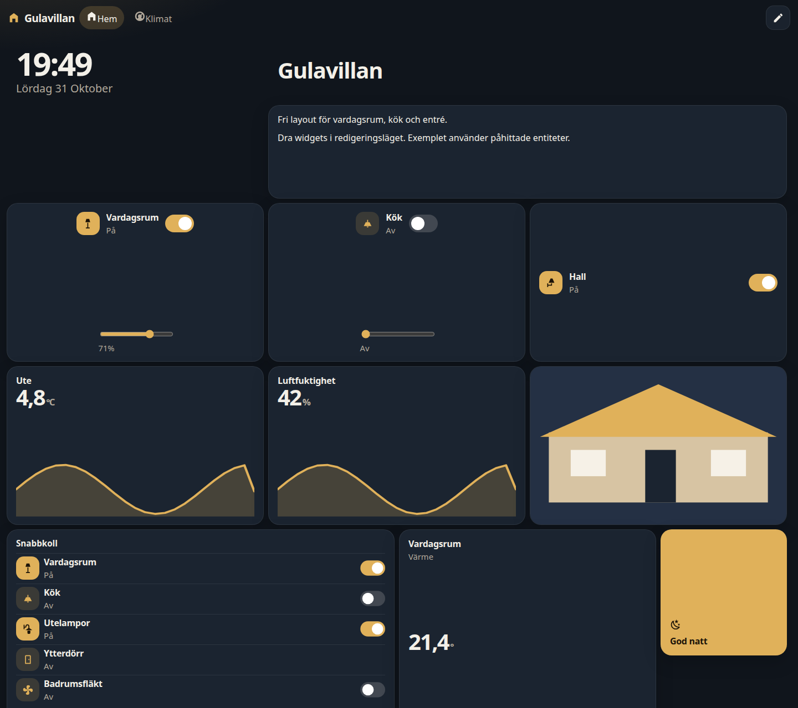
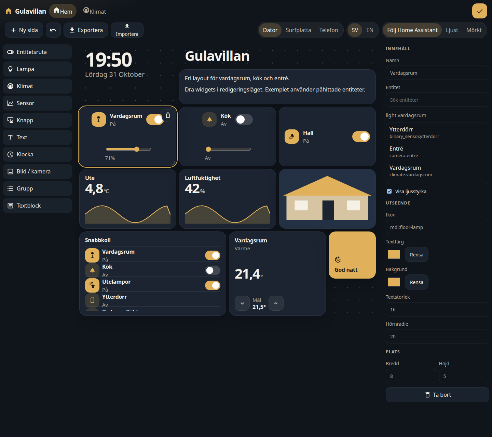
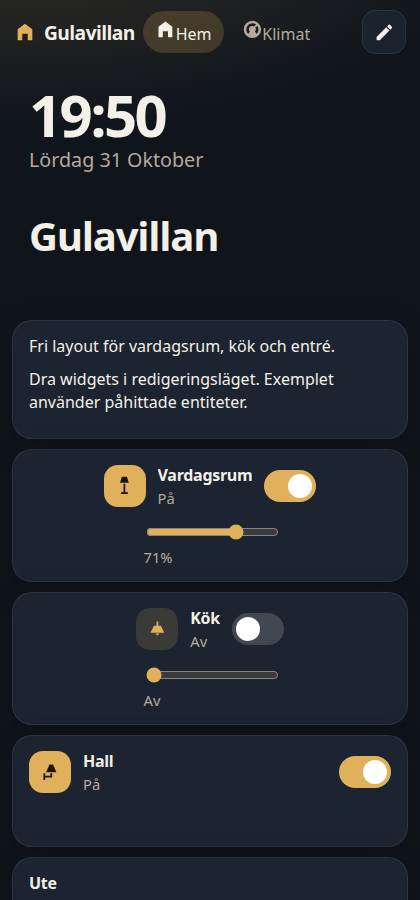
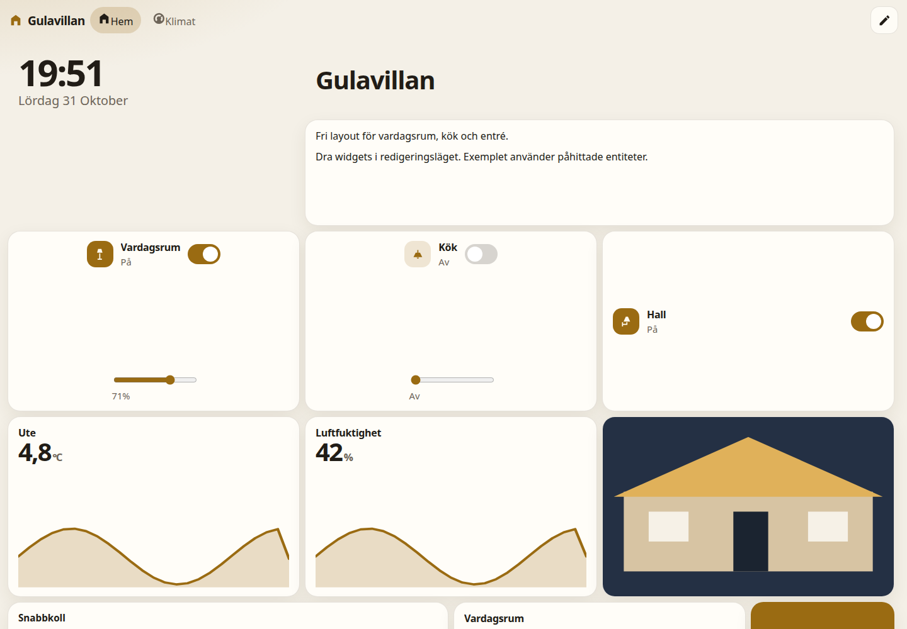

# Gulavillan

En fri dashboard som sidopanel i Home Assistant. Lovelace-byggaren räcker inte när layouten ska kunna se ut hur som helst: här lägger du widgets på en yta, drar dem, ändrar storlek och stil, och sparar allt i Home Assistant så att det följer med mellan dator, surfplatta och telefon.

Panelen använder den inloggade sessionen. Ingen extra inloggning och inga tokens i integrationen.





## Installation

Kräver Home Assistant Core 2026.10 eller nyare, och [HACS](https://hacs.xyz/).

1. Öppna **HACS → Integrationer**.
2. Öppna menyn uppe till höger och välj **Anpassade arkiv** (Custom repositories).
3. Klistra in `https://github.com/Aquilo77/ha-gulavillan-dashboard`.
4. Välj kategori **Integration** och lägg till arkivet. Starta inte om ännu.
5. Sök upp **Gulavillan** i HACS och öppna det. Tryck på **Ladda ner** (Download) och vänta tills nedladdningen är klar.
6. Starta om Home Assistant först nu.
7. Gå till **Inställningar → Enheter och tjänster → Lägg till integration** och välj **Gulavillan**.
8. Välj titel (förvalt **Gulavillan**), ikon och om panelen bara ska synas för administratörer.

HACS tar bort anpassade arkiv som inte har laddats ner när Home Assistant startar om. Arkivet måste alltså laddas ner i HACS innan omstarten, annars försvinner det.

Ingen YAML behövs. Efter omstarten finns panelen i sidomenyn.

Utan en publicerad GitHub-release installerar HACS standardgrenen. När en version taggas som `vX.Y.Z` (samma version som i `manifest.json`) visas den som valbar version. Arbetsflödet `.github/workflows/release.yml` bygger panelen och lägger ett zip-arkiv på releasen.

## Använda panelen

Gränssnittet är svenska från start. I redigeringsläget kan du byta till engelska. Temat följer Home Assistant, eller sätts till ljust eller mörkt.

- Pennan uppe till höger öppnar redigering. Bara administratörer kan ändra layouten.
- Lägg till en widget från listan till vänster. På smalare skärmar ligger listan överst.
- Dra widgeten på rutnätet. Den fäster mot rutorna. Dra i nedre högra hörnet för att ändra storlek.
- Till höger (eller i en panel nedtill på liten skärm) ställer du in innehåll och utseende: färg, bakgrund, textstorlek, ikon och hörnradie.
- Sidor är flikar. Lägg till, byt namn eller ta bort en sida.
- På telefon staplas widgets i en kolumn. Från ungefär 640 pixlars bredd, alltså surfplatta och dator, ligger de fritt.
- Ändringar sparas i Home Assistant (`.storage/gulavillan_dashboard.layout`) och syns på alla enheter.
- Exportera layouten som JSON, eller importera en fil. Ett exempel med påhittade entiteter finns i [`examples/hem.json`](examples/hem.json).





Entitetslistan söker bland riktiga `hass.states`. Knappar anropar tjänster via `hass.callService`, med samma behörighet som den inloggade användaren. Sensorernas kurva hämtas från historiken.

### Widgetar

| Widget | Vad den gör |
| --- | --- |
| Entitetsruta | Tillstånd och av/på när domänen stödjer det |
| Lampa | Av/på och ljusstyrka |
| Klimat | Nuvarande och måltemperatur |
| Sensor | Värde och sparkline från historiken |
| Knapp | Anropar valfri tjänst, med valfri bekräftelse |
| Text | Egen etikett |
| Klocka | Tid och datum |
| Bild / kamera | Kamera, bildentitet eller en sökväg/adress |
| Grupp | Flera entiteter i en lista |
| Textblock | Markdown, eller HTML utan skript |

## Utveckling

Frontend byggs med Vite och Lit. Den färdiga filen committas, så en HACS-installation inte behöver något byggsteg.

```bash
cd frontend
npm ci
npm test
npm run build
```

`npm test` typkontrollerar, kör layouternas tester, bygger bundle och kontrollerar att `custom_components/gulavillan_dashboard/frontend/gulavillan-panel.js` innehåller panelen. `npm run dev` öppnar en förhandsvisning med påhittade entiteter.

Python-tester (Home Assistant 2026.10, Python 3.14):

```bash
pip install -r requirements_test.txt
pytest
```

GitHub Actions kör frontend-tester, pytest, hassfest och HACS-validering.

## Begränsningar

- En gemensam layout för hela installationen, inte en per användare.
- Bara administratörer kan spara layouten. Andra kan visa den och styra det de redan har behörighet till.
- HTML-blocket tar bort skript, formulär och farliga attribut.
- Sparkline kräver att historik (Recorder) är påslagen. Annars visas bara det aktuella värdet.
- Telefonvyn är en staplad lista. Den fria ytan används på surfplatta och dator.
- Bildadresser får vara en sökväg i Home Assistant eller `http`/`https`. `javascript:` och `data:` från användaren stoppas.
